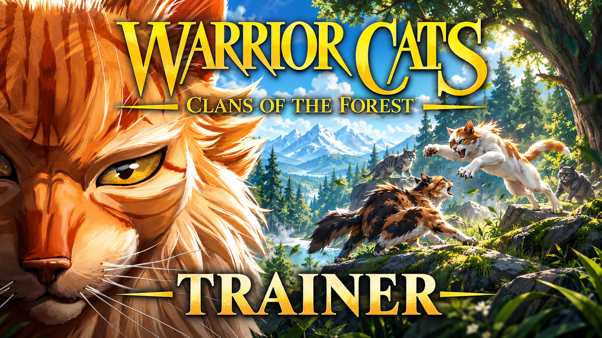

# Warrior Cats: Clans of the Forest — Trainer

**Every fur pattern, marking and eye colour unlocked. Wider battle timing windows. All four Clan campaigns open. Nine lives. Larger text.**

    

> **[⬇️ Download the latest Warrior Cats trainer](../../releases/latest)**

    

[Start here](#start-here) · [Settings](#settings) · [Den visits](#about-den-visits) · [Questions](#questions)

---

> [!NOTE]
> Single-player story game. There is no competitive mode and no anti-cheat. The only thing other people can see is your den — more on that below.

## Start here

Most pages like this open with a list of everything. This one asks a question first, because four very different people play this game and they want completely different things from it.

### "I'm here to make my cat"

For a lot of the Warrior Cats fandom, the character creator *is* the game. You have an original character in your head — specific tabby markings, a particular torn ear, the right shade of amber eyes — and the game gives you most of a toolkit for it.

**Unlock all fur patterns**, **unlock all markings and eye colours**, and **edit your cat at any time** are the three that matter. The last one is quietly the most useful: the base game locks your appearance after creation, so one wrong click at the start means living with it. These let you keep tweaking.

If you want colours the palette does not offer, **custom colour values** opens it up completely.

### "I'm here for the story"

Four campaigns, one per Clan, with branching prophecies. **Unlock all four Clan campaigns** lets you start wherever you like instead of earning your way across.

Everything that tells you where a choice leads is tagged `spoiler` and switched off. Branching is the reason to replay this, and a map of the branches is a map of the plot.

For reading comfort: **text size**, **no dialogue timer**, **text speed**.

### "The battles are too hard"

Combat is turn-based but rewards timing, and timing is where people get stuck.

**Battle timing window** widens the input window without playing the fight for you — you still choose moves, read weaknesses and decide when to call on StarClan. **Enemy health** as a slider is the gentler version of invincibility.

If a single fight is blocking the story entirely, **infinite health** will get you past it, and turning it back off afterward costs nothing.

### "I want everything"

**All moves and stances**, **all den decorations**, **all four campaigns**, **maximum Clan reputation**. Be aware that reputation and rank write to your save permanently, and the game was not built for those to change out of order.

## Settings

### Your cat

| Setting | Scope |
|---|---|
| Unlock all fur patterns | `save` |
| Unlock all colours and markings | `save` |
| Unlock all eye colours | `save` |
| Unlock all ear, tail and whisker types | `save` |
| Custom colour values beyond the palette | `save` |
| Edit appearance at any time | Client |
| Save and load appearance presets | Client |
| Unlock all name prefixes and suffixes | `save` |
| Extra character slots | `save` |

### Battle

| Setting | Key | Scope |
|---|---|---|
| Infinite health | <kbd>F1</kbd> | Client |
| Infinite energy for moves | <kbd>F2</kbd> | Client |
| Battle timing window `1x`–`5x` | slider | Client, `comfort` |
| Auto-perfect timing | <kbd>F3</kbd> | Client, `bypass` — off by default |
| Damage multiplier `1x`–`25x` | slider | Client |
| Enemy health `10%`–`200%` | slider | Client |
| StarClan ancestor attacks always ready | <kbd>F4</kbd> | Client |
| Unlock all Clan moves | — | `save` |
| Unlock all combat stances | — | `save` |
| Reveal enemy weaknesses | — | Client |
| Skip a battle | <kbd>F5</kbd> | `bypass` — off by default |
| No lasting injuries | — | Client |

The timing slider and auto-perfect do different jobs. Widening the window means you still have to press at roughly the right moment, which is the part that feels good. Auto-perfect presses for you.

### Clan life

| Setting | Key | Scope |
|---|---|---|
| Infinite prey in the fresh-kill pile | <kbd>F6</kbd> | Client |
| Herbs never run out | — | Client |
| Clan rank — kit to leader | slider | `save` |
| Nine lives as leader | <kbd>F7</kbd> | Client |
| Reputation with each Clan `0%`–`100%` | sliders | `save` |
| Instant apprentice training | — | `save` |
| Experience multiplier `1x`–`50x` | slider | Client |
| Relationships always positive | — | `save` |

### Story

| Setting | Scope |
|---|---|
| Unlock all four Clan campaigns | `save` |
| Reveal choice outcomes | `spoiler` — off by default |
| Reveal prophecies early | `spoiler` — off by default |
| Chapter select | `spoiler` — off by default |
| Unlock the ending gallery | `spoiler` — off by default |
| Skip dialogue | Client |
| Text speed `1x`–`10x` | Client |
| No dialogue timer | Client, `comfort` |
| Replay any chapter | Client |

### Forest

| Setting | Key | Scope |
|---|---|---|
| Reveal the full map | <kbd>F8</kbd> | Client |
| Fast travel anywhere | <kbd>F9</kbd> | Client |
| Highlight prey and herbs | slider | Client, radius `10`–`200 m` |
| Movement speed `1x`–`5x` | slider | Client |
| Time of day | slider | Client |
| Season | dropdown | Client — leaf-bare through greenleaf |
| Unlock all territories | `save` | — |

### Den

| Setting | Scope |
|---|---|
| Unlock all den decorations | `save` |
| Unlimited den space | `save` |
| Free decoration placement | Client |
| Unlock all collectible items | `save` |
| Feral Edition cosmetics | `paid` — off by default, see below |

> [!WARNING]
> **Feral Edition content is something people paid for.** The $39.99 edition includes extra customisation and photo mode bonuses on top of the base game. Unlocking those is different from unlocking progression you could have earned by playing — it is skipping a purchase, and it is tagged `paid` and disabled by default for that reason.
>
> If you own the Feral Edition already, the setting does nothing. If you do not, that is the developers' $10 and the choice is yours to make deliberately rather than by accident.

### Display and reading

| Setting | Key | Scope |
|---|---|---|
| Text size `75%`–`250%` | slider | Client, `comfort` |
| Interface scale `75%`–`200%` | slider | Client |
| High-contrast dialogue boxes | — | Client, `comfort` |
| Free camera | <kbd>F11</kbd> | Client |
| Hide interface | <kbd>F12</kbd> | Client |
| Field of view `60`–`110 deg` | slider | Client |
| Extended photo mode | — | Client |
| Disable screen shake | — | Client |

Text size goes up to 250% because a lot of the people playing this are reading a great deal of dialogue, sometimes on a laptop, sometimes at an age where small text is genuinely hard. It reveals nothing and it is probably the most-used setting on this page.

## About den visits

The one thing in this game other people can see is your den. Friends can drop in asynchronously, look at your cat and look at what you have collected.

Nothing here reaches them directly — there is no competition, no ranking, nothing to win. But a den full of decorations you unlocked in one click is a slightly different thing to show someone than a den you filled over thirty hours, and it is worth knowing that is the difference before you do it.

No judgement either way. Just worth saying out loud.

## Keys

<kbd>Insert</kbd> opens the menu · <kbd>End</kbd> resets everything · <kbd>F1</kbd> health · <kbd>F2</kbd> energy · <kbd>F3</kbd> auto-timing · <kbd>F4</kbd> StarClan attacks · <kbd>F5</kbd> skip battle · <kbd>F6</kbd> prey · <kbd>F7</kbd> nine lives · <kbd>F8</kbd> reveal map · <kbd>F9</kbd> fast travel · <kbd>F11</kbd> free camera · <kbd>F12</kbd> hide HUD

All of them can be changed. Arrow keys and <kbd>Enter</kbd> work if you would rather not use the mouse.

## Questions

Can I get banned or in trouble for this?

No. It is a single-player story game with no competitive mode, no leaderboards and no anti-cheat. Achievements unlock normally, and there is a switch to stop them if you would rather earn them properly.

Can I change my cat's appearance after creating it?

Yes, with "edit appearance at any time" in the first section. The base game locks your cat in once the story starts, which is the most common complaint from people who got one detail wrong and did not notice for ten hours.

Does it spoil the story?

Only if you turn on something tagged <code>spoiler</code>, and all four of those are off when you install it. Choice outcomes, prophecies, chapter select and the ending gallery all show you things the campaigns are built to reveal slowly.

I'm stuck on one battle and I just want to see what happens next.

Infinite health, or enemy health at 25%. Both get you through, and you can switch them off on the other side. Skipping the battle entirely is also there, though a fight you skip is a fight you never find out whether you could have won.

Is the text size setting actually part of this?

Yes, up to 250%, along with interface scale and high-contrast dialogue boxes. These change nothing about the game except how readable it is.

Does it work on Epic, or on console?

Steam and Epic both work — launch through whichever client you bought it from. The PlayStation, Xbox and Switch versions cannot run anything like this; console systems do not allow it.

Will it break my save?

Settings marked <code>save</code> write permanently — rank, reputation, unlocked campaigns, customisation. The game expects those to change in a particular order, so a backup first is sensible. Everything else only lasts while the game is running.

Some settings stopped working after an update.

When the game updates, the places in memory these settings write to move around. They stop working one at a time rather than all at once. Check whether there is a newer release here that matches your game version.

My antivirus flagged the download.

Programs that read and write another program's memory look the same to a scanner whether they are helpful or harmful, so this whole category gets flagged automatically. Each release has a checksum you can verify and the full source code is in this repository. If you would rather not add an exception, that is a completely reasonable decision.

## If something goes wrong

Battle settings only work once a fight has started — they have nothing to attach to on the map screen. Customisation settings need the creator or the den mirror open. Story settings bind when a chapter loads.

If the menu will not open, another program has taken the <kbd>Insert</kbd> key. Steam's overlay and Discord are the two usual causes, and changing the key takes a moment.

If your cat looks wrong after using custom colour values, the game may not have saved the new values — reopen the editor and confirm before leaving.

Found a real problem? [Open an issue](../../issues) and include your **game build number** first, then the store, which Clan campaign, and the one setting that misbehaved.

## Version history

**1.0.0** — 25 October 2026 — first release, two days after launch. 45+ settings across Your cat, Battle, Clan life, Story, Forest, Den and Display. Story reveals, auto-timing and Feral Edition content all off by default.

---

Unofficial fan tool. No connection to Bamtang Games, Trailmark Games, Erin Hunter or HarperCollins. Warrior Cats and everything in it belongs to its owners. Changing a running game's memory can cause crashes or damage a save file, so keep a backup. MIT licence.

